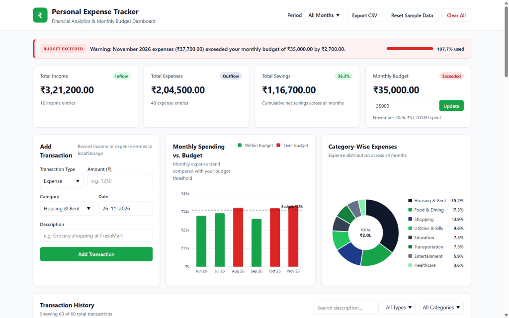
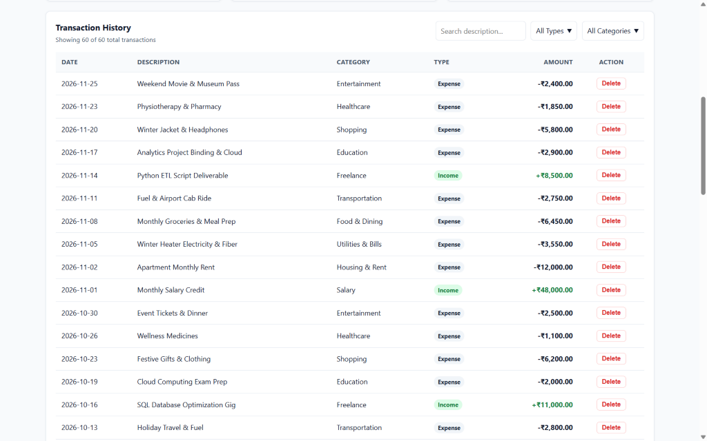

# Personal Expense Tracker and Budget Dashboard

An end-to-end **College Data Analyst Project** that combines a responsive web-based Personal Expense Tracker, an automated Python & Pandas ETL and analytics pipeline, an Oracle SQL & PL/SQL database layer, and Power BI dashboard resources.

---

## 1. Project Introduction

Effective personal financial management requires capturing daily income and expense transactions, monitoring spending against monthly budgets, and transforming raw transaction logs into actionable analytical insights. **Personal Expense Tracker and Budget Dashboard** delivers a unified workflow spanning interactive frontend transaction entry, automated data cleaning and statistical aggregation in Python, relational storage and budget auditing in Oracle Database, and executive BI visualization in Power BI.

## 2. Problem Statement

Individuals and students frequently track expenses using fragmented spreadsheets or manual notes, leading to:
- Inconsistent category labels, missing fields, and duplicate records.
- Delayed awareness of monthly budget overruns.
- Lack of integrated KPIs connecting daily transaction tracking with historical trend analysis and database-backed auditing.

## 3. Objectives

- Build a responsive, browser-based Personal Expense Tracker with real-time KPI cards, interactive charts, budget warnings, and `localStorage` persistence.
- Implement a reproducible Python & Pandas pipeline to clean raw transaction CSVs, standardize categories, calculate monthly and category-level metrics, and export Power BI-ready datasets.
- Design a normalized Oracle SQL schema (`BUDGET` and `EXPENSES`), analytical reporting queries, and a PL/SQL stored procedure (`check_monthly_budget`) for automated budget threshold alerts.
- Provide clean datasets, DAX measures, a custom theme, and a complete layout specification for Power BI Desktop reporting.
- Ensure 100% numerical consistency across the frontend dataset, Python CSV exports, and Oracle SQL sample data.

## 4. Features

- **Frontend Financial Dashboard (`index.html`)**
  - Four live KPI cards: **Total Income**, **Total Expenses**, **Total Savings** (with savings rate %), and editable **Monthly Budget**.
  - Add and delete Income/Expense transactions with dynamic category selection, date, and description validation.
  - Real-time **Budget Limit Warning** banner and utilization progress bar (`On Track`, `Near Limit >= 80%`, `Exceeded > 100%`).
  - Interactive HTML5 Canvas **Monthly Spending vs. Budget** bar chart and **Category-Wise Expenses** donut chart with hover tooltips.
  - Filterable Transaction History (by period, type, category, and search query) plus **Export CSV**, **Reset Sample Data**, and **Clear All** actions.
  - Persistent client-side storage via browser `localStorage`.
- **Python Data Analysis (`data_cleaning.py`, `expense_analysis.py`)**
  - Automated CSV ingestion, whitespace/casing normalization, missing value handling, keyword-based category imputation, and duplicate removal.
  - Monthly income, expense, savings, savings rate, month-over-month expense change, and budget variance calculations.
  - Category-wise spend, transaction count, average transaction value, and percentage share breakdown.
  - Multi-table CSV exports formatted for Power BI.
- **Oracle SQL & PL/SQL (`database/`)**
  - `BUDGET` and `EXPENSES` tables with primary keys, foreign key constraint, check constraints, and analytical indexes.
  - Pre-populated 6-month dataset (`60` cleaned transactions).
  - Five commented analytical SQL queries and a PL/SQL budget audit procedure (`check_monthly_budget`).
- **Power BI Resources (`powerbi/`)**
  - Five cleaned CSV datasets, copy-paste DAX measures (`dax_measures.dax`), custom JSON theme (`theme.json`), and a step-by-step dashboard build guide.

## 5. Technologies Used

| Layer | Technologies |
| :--- | :--- |
| **Frontend** | HTML5, CSS3 (Responsive Grid/Flexbox), Vanilla JavaScript (ES6+), HTML5 Canvas, `localStorage` |
| **Data Analysis** | Python 3, Pandas |
| **Database** | Oracle SQL, Oracle PL/SQL (`DBMS_OUTPUT`) |
| **Business Intelligence** | Microsoft Power BI Desktop, DAX, Power Query |
| **Version Control** | Git, GitHub |

## 6. Folder Structure

```text
personal-expense-tracker/
├── index.html                          # Main web dashboard entry point
├── css/
│   └── styles.css                      # Clean white, dark navy & green responsive styling
├── js/
│   ├── sample-data.js                  # Canonical 60-transaction dataset & defaults
│   ├── charts.js                       # Zero-dependency Canvas monthly & category charts
│   └── app.js                          # State management, KPIs, filters & localStorage
├── data/
│   └── raw_transactions.csv            # Raw 63-row sample CSV (with dirty test cases)
├── data_cleaning.py                    # Pandas cleaning, deduplication & imputation module
├── expense_analysis.py                 # Main Python analysis & Power BI CSV export script
├── requirements.txt                    # Python package dependencies
├── database/
│   ├── schema.sql                      # Oracle DDL for BUDGET and EXPENSES tables
│   ├── sample_data.sql                 # Oracle INSERT script (6 budgets, 60 transactions)
│   ├── queries.sql                     # KPI, category, and monthly analytical queries
│   └── budget_check.sql                # PL/SQL procedure check_monthly_budget
├── powerbi/
│   ├── cleaned_transactions.csv        # Exported fact table (60 rows)
│   ├── budget_targets.csv              # Exported monthly budget targets (6 rows)
│   ├── monthly_summary.csv             # Exported monthly KPI summary (6 rows)
│   ├── category_summary.csv            # Exported category breakdown (8 categories)
│   ├── monthly_category_breakdown.csv  # Exported month x category matrix
│   ├── dax_measures.dax                # Ready-to-use Power BI DAX measures
│   ├── theme.json                      # Power BI clean white/navy/green theme
│   └── powerbi_dashboard_guide.md      # Step-by-step Power BI Desktop build guide
├── docs/
│   ├── project_report.md               # Formal college submission report
│   └── screenshots/
│       ├── dashboard_overview.png      # Desktop KPI, alert & charts screenshot
│       └── dashboard_transactions.png  # Transaction history & filters screenshot
├── FINAL_SUBMISSION_CHECKLIST.md       # Final submission & manual execution checklist
├── .gitignore
└── README.md
```

## 7. System Architecture

```text
+--------------------------+        Export CSV         +---------------------------+
|   Frontend Web App       | ------------------------> |   Raw Transaction CSV     |
| (HTML/CSS/JS + Canvas)   |                           | (data/raw_transactions)   |
|  - localStorage state    |                           +-------------+-------------+
+--------------------------+                                         |
                                                                     v
+--------------------------+                           +---------------------------+
|   Oracle Database        |                           |   Python & Pandas ETL     |
|  - schema.sql            |                           |  - data_cleaning.py       |
|  - sample_data.sql       |                           |  - expense_analysis.py    |
|  - queries.sql           |                           +-------------+-------------+
|  - budget_check.sql      |                                         |
+--------------------------+                                         v
                                                       +---------------------------+
                                                       |   Power BI Datasets       |
                                                       |  - powerbi/*.csv          |
                                                       |  - dax_measures.dax       |
                                                       |  - powerbi_dashboard_guide|
                                                       +---------------------------+
```

## 8. Database Design

The Oracle relational model (`database/schema.sql`) uses two linked tables:

1. **`BUDGET`**:
   - `BUDGET_ID` (`NUMBER(10)`, Primary Key)
   - `BUDGET_MONTH` (`CHAR(7)`, Unique, `YYYY-MM` format check)
   - `BUDGET_LIMIT` (`NUMBER(12, 2)`, Positive check)
   - `CREATED_AT` (`DATE`, Default `SYSDATE`)
2. **`EXPENSES`**:
   - `TRANSACTION_ID` (`VARCHAR2(20)`, Primary Key)
   - `TX_DATE` (`DATE`, Not Null)
   - `BUDGET_MONTH` (`CHAR(7)`, Foreign Key referencing `BUDGET(BUDGET_MONTH)`)
   - `TRANSACTION_TYPE` (`VARCHAR2(10)`, Check `'Income'` or `'Expense'`)
   - `CATEGORY` (`VARCHAR2(50)`, Not Null)
   - `DESCRIPTION` (`VARCHAR2(200)`, Not Null)
   - `AMOUNT` (`NUMBER(12, 2)`, Positive check)

A PL/SQL stored procedure `check_monthly_budget(p_month)` in `database/budget_check.sql` audits a target month's expenses against `BUDGET_LIMIT` and outputs `STATUS OK`, `CAUTION` (`>= 80%`), or `WARNING: Budget limit EXCEEDED` via `DBMS_OUTPUT`.

## 9. Python Methodology

1. **Ingestion (`data_cleaning.py`)**: Reads `data/raw_transactions.csv` (`63` raw rows).
2. **Validation & Missing Value Handling**: Parses dates and numeric amounts; drops rows missing a valid date or positive amount (`1` corrupted row removed); fills empty descriptions; infers missing categories from description keywords (`1` missing category imputed as `Healthcare`); standardizes category/type casing.
3. **Deduplication**: Removes duplicate transactions by `transaction_id` and composite transaction fields (`2` duplicate rows removed), yielding `60` clean canonical rows.
4. **Aggregation & Export (`expense_analysis.py`)**: Computes overall KPIs, monthly summary (`monthly_summary.csv`), category breakdown (`category_summary.csv`), month-category breakdown (`monthly_category_breakdown.csv`), and budget targets (`budget_targets.csv`) into `powerbi/`.

## 10. Power BI Dashboard Details

All Power BI resources are stored in [`powerbi/`](./powerbi/):
- **Data Model**: One-to-many (`1:*`) single-direction relationship from `budget_targets[budget_month]` to `cleaned_transactions[year_month]`.
- **Visuals**: 4 KPI Cards, Monthly Spending Line Chart with Budget Limit reference, Category-Wise Expense Pie Chart, Income vs. Expense Clustered Column Chart, and Monthly Audit Table with conditional formatting.
- Follow [`powerbi/powerbi_dashboard_guide.md`](./powerbi/powerbi_dashboard_guide.md) to assemble and save the `.pbix` file in Power BI Desktop.

## 11. Installation Instructions

1. Clone the repository:
   ```bash
   git clone https://github.com/Devansh0Tyagi-Codes/personal-expense-tracker.git
   cd personal-expense-tracker
   ```
2. Install Python dependencies (Python 3.10+ recommended):
   ```bash
   pip install -r requirements.txt
   ```

## 12. How to Run the Project

### A. Run the Frontend Dashboard
Open `index.html` directly in any modern web browser, or serve locally via Python:
```bash
python -m http.server 8000
```
Then visit `http://localhost:8000` in your browser.

### B. Run the Python Data Analysis Pipeline
```bash
python expense_analysis.py
```
Optional arguments:
```bash
python expense_analysis.py --input data/raw_transactions.csv --output-dir powerbi --budget 35000
```

### C. Run Oracle SQL & PL/SQL Scripts
Execute the scripts in order inside Oracle SQL*Plus, SQL Developer, or Oracle Live SQL (requires an Oracle Database environment):
```sql
@database/schema.sql
@database/sample_data.sql
@database/queries.sql
@database/budget_check.sql
```

## 13. Dashboard Screenshots

### Financial Overview, Budget Alert & Interactive Charts


### Transaction History & Multi-Filter Table


## 14. Results

Across the 6-month canonical dataset (**June 2026 – November 2026**, `60` cleaned transactions with a monthly budget of **₹35,000.00**):

- **Total Income:** ₹321,200.00 (`12` income entries)
- **Total Expenses:** ₹204,500.00 (`48` expense entries)
- **Total Savings:** ₹116,700.00 (**36.33%** overall savings rate)
- **Top Expense Category:** `Housing & Rent` — ₹72,000.00 (**35.21%** of total expenses), followed by `Food & Dining` at ₹35,300.00 (**17.26%**)
- **Months Exceeding ₹35,000 Budget:**
  - `2026-08` (Aug 2026): ₹36,450.00 (Over by ₹1,450.00)
  - `2026-10` (Oct 2026): ₹36,200.00 (Over by ₹1,200.00)
  - `2026-11` (Nov 2026): ₹37,700.00 (Over by ₹2,700.00)

## 15. Conclusion

The project successfully demonstrates an integrated Data Analyst workflow—from interactive client-side expense capture to automated Pandas ETL cleaning, Oracle relational database querying and PL/SQL budget enforcement, and executive BI dashboarding—while maintaining exact numerical consistency across all layers.

## 16. Future Scope

- Connect the frontend directly to a REST API backend (Flask/FastAPI) backed by Oracle Database for multi-user persistence.
- Add recurring transaction scheduling and automated bank/UPI statement PDF/CSV parsing.
- Implement time-series expense forecasting (ARIMA / Prophet / linear regression) to predict next-month budget risk early.
- Add role-based authentication and automated email/SMS budget threshold notifications.
